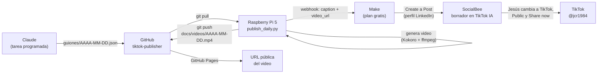

# Flujo de publicación en TikTok

Estado: funcionando de punta a punta en modo semi-automático (20 oct 2026). Primer video
publicado así: "You don't need microservices (yet)". Falta el cron y la tarea de Claude.

Para instalar y usar los scripts, ver [LEEME.md](LEEME.md).

## Resumen

Cada día hábil se publica en TikTok un video corto (20–45 s) sobre tecnología y liderazgo,
con voz, titular en pantalla y subtítulos. Todo es gratis: el video se genera en una
Raspberry Pi 5 y se publica a través de SocialBee. Jesús revisa y publica cada post (unos clics).



## Paso a paso

| # | Quién | Cuándo | Qué hace |
|---|-------|--------|----------|
| 1 | Claude (tarea programada) | Lunes a viernes, mañana | Investiga el tema del día, escribe el guion (slides, `caption`, `hashtags`) y lo guarda en `guiones/AAAA-MM-DD.json`. |
| 2 | Raspberry (cron) | Después de Claude | `publish_daily.py`: `git pull`, genera `docs/videos/AAAA-MM-DD.mp4`, lo sube a GitHub, espera a que Pages lo publique y avisa a Make. |
| 3 | Make | Al instante | Escenario "Integration Webhooks": webhook → SocialBee *Create a Post*. |
| 4 | SocialBee | Al instante | El post llega como **borrador**, con video y descripción, a la categoría "TikTok IA" — pero asignado al perfil de **LinkedIn** (ver "Truco del perfil"). |
| 5 | Jesús | Cuando quiera | Abre el borrador, cambia el perfil a TikTok, elige **Public** y le da **Share now**. |

### Truco del perfil (por qué el borrador llega a LinkedIn)

SocialBee exige elegir la privacidad de TikTok al crear cualquier post de TikTok, **incluso
borradores**, y el módulo *Create a Post* de Make **no envía** el campo de privacidad para TikTok
(solo para YouTube). Se probaron todos los valores, mapeados y fijos, y "Make an API Call" con
`POST /posts` (responde 403). Soporte de SocialBee quedó avisado.

Por eso Make crea el borrador para el perfil de LinkedIn (que no pide privacidad) y Jesús lo
cambia a TikTok en el editor de SocialBee:

1. Categoría **TikTok IA** → el borrador del día → **Edit**.
2. Quitar LinkedIn, seleccionar TikTok (en el aviso "Add TikTok profile" → **Proceed**).
3. Dejar **una sola variación** (borrar la que tenga el triángulo rojo).
4. Privacidad **Public** (no "Only me": un video privado publicado por API no se puede hacer
   público después), **Comment** marcado, **Re-queue after posting apagado**.
5. **Update post** → **Share now** → seleccionar el ícono de TikTok → **Share**.

Cuidado: el borrador llega con LinkedIn. Si se aprueba sin cambiar el perfil, se publicaría en LinkedIn.

Temas por día (los mismos que LinkedIn): lunes CEO/liderazgo, martes IA, miércoles ingeniería
de software/arquitectura, jueves founders/startups, viernes tendencias tech.

## Componentes y cuentas

| Componente | Detalle |
|-----------|---------|
| Repositorio | `JesusCabreraReveles/tiktok-publisher` (público, rama `master`) |
| GitHub Pages | Rama `master`, carpeta `/docs` → `https://jesuscabrerareveles.github.io/tiktok-publisher/` |
| Raspberry Pi 5 (4 GB) | Usuario `chch`, proyecto en `~/tiktok-publisher`, entorno `.venv` |
| Escritura desde la Raspberry | Deploy key `~/.ssh/tiktok_deploy` con permiso de escritura, solo en este repositorio |
| Escritura desde Claude | App "Claude Github MCP Connector" instalada solo en este repositorio |
| Voz | Kokoro int8 (`voices/`, ~120 MB). Inglés `am_michael`, español `em_alex` |
| Make | Plan gratis (1,000 créditos/mes). El flujo usa 2 créditos por video (~44/mes) |
| SocialBee | Workspace "My Workspace", perfil TikTok `jcr1984` en *Direct posting*, categoría "TikTok IA" |
| App de TikTok for Developers | "JCR-PUBLISHER" en la organización "JESUS CABRERA". Solo Sandbox, para pruebas |

## Configuración

### `config.json` (solo en la Raspberry, nunca en GitHub)

| Campo | Uso |
|-------|-----|
| `make_webhook_url` | URL del webhook de Make. Es secreta: quien la tenga puede crear posts. |
| `pages_base_url` | `https://jesuscabrerareveles.github.io/tiktok-publisher/` |
| `client_key`, `client_secret`, `redirect_uri`, `scopes` | Solo para `tiktok_upload.py` (Sandbox). |

### Escenario de Make "Integration Webhooks"

1. **Webhooks → Custom webhook** "tiktok-publisher" (recibe `date`, `caption`, `video_url`, `lang`, `privacy`).
2. **SocialBee → Create a Post**:
   - Workspace: My Workspace
   - Profiles: **Jesus Cabrera Reveles (LinkedIn)** — ver "Truco del perfil"
   - Category: **TikTok IA**
   - Text: `caption`
   - Media URL: `video_url`
   - Approved: **No** (revisarlo tras cada edición: se ha cambiado solo a "Yes")
   - Privacy Status y Title vacíos; sin hora de publicación y sin expiración
3. Programación: *Immediately as data arrives*, escenario activo.
4. Si un paso falla, Make **apaga el escenario** y manda un correo: corregir, borrar la cola
   (Webhooks → tiktok-publisher → Queue) y reactivar.

### Cron de la Raspberry (pendiente de activar)

La Raspberry debe estar en hora de Ciudad de México (`sudo timedatectl set-timezone America/Mexico_City`).
Con `crontab -e`:

```cron
15 9 * * 1-5  cd /home/chch/tiktok-publisher && mkdir -p logs && .venv/bin/python publish_daily.py >> logs/daily.log 2>&1
```

## Operación diaria

- **Revisar:** en SocialBee, categoría TikTok IA, abrir el borrador del día y seguir el "Truco del perfil".
- **Si no llegó el borrador:** revisar `logs/daily.log` en la Raspberry.
- **Volver a correr un día:** `python3 publish_daily.py --date AAAA-MM-DD`.
- **Probar sin publicar:** `python3 publish_daily.py --dry-run`.
- **Plan B:** si falla Make o SocialBee, el video está en
  `https://jesuscabrerareveles.github.io/tiktok-publisher/videos/AAAA-MM-DD.mp4` y la descripción
  en el guion del día. Se descarga y se sube a mano desde la app de TikTok.

## Problemas comunes

| Síntoma | Causa probable | Qué hacer |
|---------|----------------|-----------|
| `No script for AAAA-MM-DD` | Claude no dejó el guion ese día | Revisar la tarea programada de Claude. |
| `git push` pide contraseña o falla | Deploy key | Verificar `git config core.sshCommand` y la key en Settings → Deploy keys. |
| `The video never went live` | GitHub Pages no se actualizó | Revisar Actions/Pages en el repositorio. |
| Make no crea el post | Escenario apagado o webhook cambiado | Activar el escenario; revisar `make_webhook_url`. |
| El post no se publica tras aprobarlo | Hora fija vencida o expiración | No usar hora fija ni "Expire after" (igual que en LinkedIn). |

## Lecciones aprendidas

- **TikTok no acepta texto solo**: cada post necesita video o imágenes.
- **API directa de TikTok descartada**: una app sin auditar solo puede publicar en *cuentas privadas*
  (`unaudited_client_can_only_post_to_private_accounts`), y TikTok no aprueba herramientas que
  solo publican en cuentas propias.
- **SocialBee sí publica en público** en TikTok porque su app ya está aprobada (probado el 20 oct 2026).
- **El módulo de SocialBee en Make no sirve para TikTok**: descarta `privacyStatus` y SocialBee
  responde `[412] TikTok posts require a privacy mode to be chosen`, incluso con `approved: false`.
  Falla conocida (hilo "SocialBee Module - Post to TikTok - Missing Settings" en la comunidad de Make).
  "Make an API Call" con `POST /posts` → 403. Se resolvió con el truco del perfil.
- **El modo bandeja de la API de TikTok sí funciona, con retraso**: la notificación
  "Tu contenido de JCR-PUBLISHER está listo" apareció ~1 h después del envío.
- **Un video publicado como "Only me" desde una app externa no se puede volver público**:
  hay que borrarlo y publicarlo de nuevo.
- **Zapier no alcanza**: los webhooks son de pago y LinkedIn ya usa ~66 de las 100 tareas gratis.
  Por eso TikTok va por Make.
- **No hace falta GPU ni modelo de IA en la Raspberry**: el video se arma con voz Kokoro (CPU) y
  ffmpeg. Tarda ~47 s por video en la Pi 5. Claude escribe el guion.
- **Hugging Face está bloqueado** desde el entorno de Claude; los modelos de voz se descargan de GitHub.
- **Inicio de sesión en TikTok**: si se hacen varios intentos seguidos, TikTok bloquea temporalmente.
  Usar el código QR desde el celular, que además evita entrar con la cuenta equivocada.
- **GitHub con varias cuentas**: este proyecto usa `JesusCabreraReveles`. Los permisos de Claude
  y de la Raspberry están limitados a este repositorio.

## Pendientes

1. Respuesta del soporte de SocialBee sobre la privacidad de TikTok. Si la arreglan, cambiar el
   módulo de Make al perfil de TikTok y quitar el truco del perfil.
2. Activar el cron en la Raspberry.
3. Agregar a la tarea programada de Claude la escritura del guion diario en `guiones/`.
4. Revisar la zona horaria de los perfiles en SocialBee: muestran GMT-05:00 y Ciudad de México
   es GMT-06:00 todo el año.
5. Licencia de SocialBee marcada "cancelling": revisar con soporte. Si se cancela, el flujo se cae
   (usar el plan B).
6. Opcional: borrar videos viejos de `docs/videos/` para que el repositorio no crezca de más
   (~1 MB por video).
7. Post de libro los miércoles (LinkedIn y TikTok), además del post normal: rotación sin repetir
   entre los libros del proyecto "Publicaciones", con enlaces de Amazon limpios (`/dp/CODIGO`).
8. Opcional: regenerar la URL del webhook de Make (se mostró en una captura).
